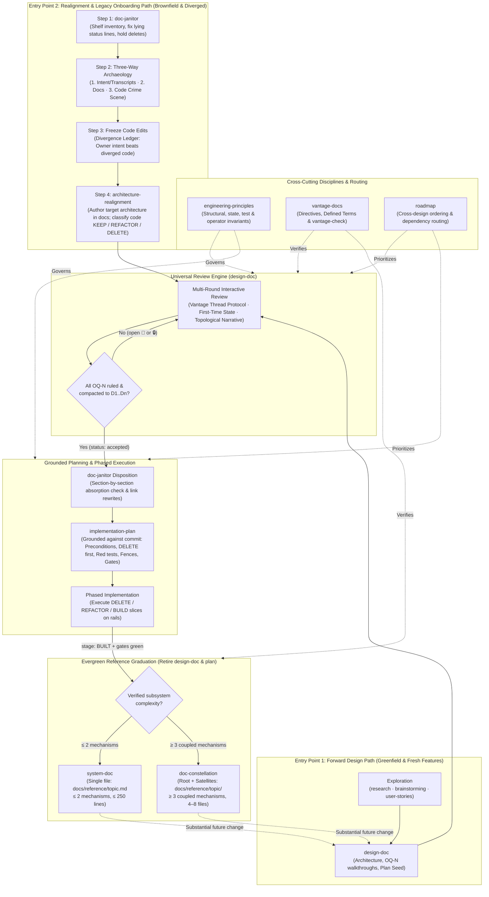
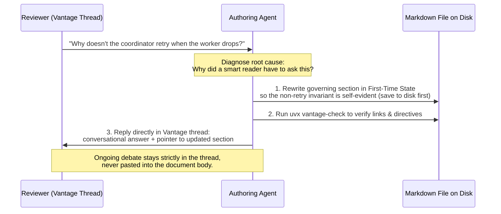

# The matt-craft document and architecture lifecycle

**Status:** Verified 2026-10-31 against `546633a`.

`matt-craft` is an opinionated suite of workflow and documentation skills that moves architectural decisions out of ephemeral chat windows into a durable, machine-verifiable Markdown document lifecycle. It governs how engineers and AI coding agents collaborate from initial exploration or legacy onboarding through architectural deliberation, grounded implementation planning, phased execution, and evergreen reference maintenance.

| Component | Lives in |
| :--- | :--- |
| Routing briefing | [`briefing/document-lifecycle.md`](../../briefing/document-lifecycle.md) |
| Exploration skills | [`skills/research/SKILL.md`](../../skills/research/SKILL.md), [`skills/brainstorming/SKILL.md`](../../skills/brainstorming/SKILL.md), [`skills/user-stories/SKILL.md`](../../skills/user-stories/SKILL.md) |
| Shelf cleanup and disposition (`doc-janitor`) | [`skills/doc-janitor/SKILL.md`](../../skills/doc-janitor/SKILL.md) |
| Brownfield and recovery campaign (`architecture-realignment`) | [`skills/architecture-realignment/SKILL.md`](../../skills/architecture-realignment/SKILL.md) |
| Forward design and review engine | [`skills/design-doc/SKILL.md`](../../skills/design-doc/SKILL.md) |
| Cross-design prioritization | [`skills/roadmap/SKILL.md`](../../skills/roadmap/SKILL.md) |
| Grounded build hand-off | [`skills/implementation-plan/SKILL.md`](../../skills/implementation-plan/SKILL.md) |
| Evergreen references (`system-doc`, `doc-constellation`) | [`skills/system-doc/SKILL.md`](../../skills/system-doc/SKILL.md), [`skills/doc-constellation/SKILL.md`](../../skills/doc-constellation/SKILL.md) |
| Cross-cutting disciplines | [`skills/engineering-principles/SKILL.md`](../../skills/engineering-principles/SKILL.md), [`skills/vantage-docs/SKILL.md`](../../skills/vantage-docs/SKILL.md) |

**Reads with:** [`README.md`](../../README.md) (suite overview and installation) and [`briefing/document-lifecycle.md`](../../briefing/document-lifecycle.md) (the agent-context trigger table).

---

## 1. Governing principles and invariants

### P1. Durable documents own architectural state, never chat history or unverified code

Chat sessions compact, rotate, and expire; source code records *what currently executes*, including every shortcut, unapproved workaround, and drifted assumption. Every architectural commitment, open trade-off, and settled ruling lives in version-controlled Markdown checked by `vantage-check`.

### P2. Two entry points converge on one execution pipeline

Engineering work enters the lifecycle through one of two gates depending on the trustworthiness of the baseline:
- **Forward Design (`design-doc`):** For greenfield systems, fresh features, and disciplined evolution from a clean baseline.
- **Realignment & Legacy Onboarding (`architecture-realignment`):** For brownfield repositories, legacy systems being onboarded to `matt-craft`, codebases with decayed or missing documentation, and systems that suffered agentic divergence.

Both entry points converge on the same review engine (`design-doc`), the same grounded build hand-off (`implementation-plan`), and the same evergreen reference graduation (`system-doc` or `doc-constellation`).

### P3. Code is the crime scene, not the king

When onboarding a legacy codebase or recovering from agentic divergence, existing implementation code holds zero veto power over the target architecture. Agents naturally default to treating existing code as sacred authority and writing documentation that rationalizes whatever the code currently does. `architecture-realignment` inverts that default: existing code is forensic evidence of what happened, not a specification of what should survive.

### P4. Freeze production code during architectural alignment

During forward design and throughout the archaeological and design stages of `architecture-realignment`, production code edits are strictly frozen. Half-written code beside half-written documents guarantees that neither converges. Every structural contradiction and open question is resolved in documents before an implementation plan is grounded or a single production file is modified.

### P5. First-time state (zero process scarring)

Every document in the tree—whether an active `design-doc`, a single-file `system-doc`, or a multi-file `doc-constellation`—must read as if authored fresh that morning by an architect who knew all constraints from day one. Conversational explanations belong in review threads; historical ruling provenance belongs in the bottom Decision Ledger (`D1..Dn`) or Git history. The body prose never carries defensive debate notes, reviewer attributions, or changelog sediment.

### P6. Topological forward narrative (no logic puzzles)

Every document introduces concepts in strict causal dependency order: problem framing and principles precede vocabulary and data shapes, which precede intake-to-output mechanisms, which precede downstream observers and invariants. No paragraph in Section $N$ may require the reader to jump ahead to Section $M$ ($M > N$) to understand the terms or state flags in front of them.

### Core invariants

1. **Genre separation invariant:** Proposals and open questions live in `docs/design/`; concrete file-by-file build checklists live in `*-plan.md`; evergreen present-tense descriptions of built systems live in `docs/reference/`. Never mix genres in one file, and never leave a completed `design-doc` or `implementation-plan` alive after graduating its `system-doc` or `doc-constellation`.
2. **One home per planning fact:** Each document owns its `status`, `stage`, `next`, and `depends-on` keys in top-level YAML frontmatter. The `roadmap` owns relative ordering and priority rationale across documents, never copied status tables or question counts.
3. **Seat separation invariant:** Expensive reasoning seats author target architectures (`design-doc`) and high-rail gap plans; cheap parallel scouts gather mechanical inventories and forensic packets; bounded implementers execute one phased build slice at a time without re-litigating architecture; the human owner rules on open questions (`OQ-…`) and approves destructive dispositions.
4. **Absorption gate invariant:** No document in a repository is archived or deleted by `doc-janitor`, `system-doc`, or `doc-constellation` until a section-by-section absorption check proves that the surviving document carries 100% of its live claims and all inbound links across the repository are rewritten in the same atomic commit.

---

## 2. Defined terms

Every lifecycle term in `matt-craft` carries an explicit boundary exclusion:

- **Three-Way Archaeology** *(coined here)* — the forensic triangulation of a system's true baseline across sponsor intent and session transcripts, existing documentation claims, and source code reality. Not a code-only audit (which mistakes bugs and unapproved shortcuts for requirements) and not a doc-only audit (which misses undocumented runtime behavior).
- **Process Scarring** *(coined here)* — defensive commentary, reviewer attribution (*"Per review..."*, *"Clarification:"*), or chronological patch notes accreted into document body prose during review loops. Not the bottom Decision Ledger (`D1..Dn`) and not a forward-facing `> [!WARNING]` callout about a system trap.
- **Vantage Thread Protocol** *(coined here)* — the two-channel review discipline in which an agent answers a reviewer's question directly inside the Vantage comment thread while simultaneously rewriting the underlying document on disk so a fresh reader never encounters the ambiguity that prompted the question. Not copying thread replies into the document body, and not replying in chat while leaving the file on disk unchanged.
- **Topological Forward Narrative** *(coined here)* — ordering document sections and paragraphs so every domain term, data shape, and state producer is defined before the first downstream mechanism that consumes it. Not chronological discovery order and not source-directory layout order.
- **Document Constellation (`doc-constellation`)** *(coined here)* — a coordinated directory of small reference files (`docs/reference/<topic>/`) organized around a root `README.md` and satellite mechanism pages that together describe a verified complex subsystem at mechanism altitude. Not a monolithic single-file `system-doc` and not a collection of unbuilt design proposals.
- **Plan Seed** — the initial section in a companion `*-plan.md` file where the designer records non-obvious implementation traps, file touchpoints, and sequencing constraints discovered while authoring a `design-doc`. Not an executable `implementation-plan` (which requires a planner pass against a stamped commit after the design is accepted).

---

## 3. Complete lifecycle architecture

The diagram below shows how both entry points, the interactive review engine, the implementation hand-off, the reference graduation paths, and the cross-cutting skills connect:



---

## 4. Dual entry points to the engineering lifecycle

A single forward-only pipeline fails whenever a team inherits a legacy system, onboards an existing brownfield repository to `matt-craft`, or recovers a project where an autonomous agent drifted across sessions. `matt-craft` provides two explicit entry points that handle both realities without compromising document rigor.

| Dimension | Entry Point 1: Forward Design (`design-doc`) | Entry Point 2: Realignment & Legacy Onboarding (`architecture-realignment`) |
| :--- | :--- | :--- |
| **When to enter** | Greenfield projects, new subsystems, or well-bounded features on a clean, trusted baseline. | Legacy systems, brownfield repositories being brought under `matt-craft`, repos with decayed/missing docs, or systems after agentic divergence. |
| **Starting artifacts** | Problem statement, `/research` notes, `/brainstorming` trade-offs, or `/user-stories` workflows. | Cluttered or missing `docs/` shelf, historical context/transcripts, and an unaligned or diverged codebase. |
| **Authority of existing code** | Trusted context; cited via `file:line` anchors to show how adjacent components work today. | **Crime scene, not king.** Existing code has zero veto power over architecture; diverged or legacy workarounds are slated for deletion. |
| **First action** | Open `docs/design/<topic>.md` and surface architectural trade-offs as Open Questions (`OQ-…`). | Run `/doc-janitor` to inventory the shelf and fix lying status lines, then freeze code edits and run Three-Way Archaeology. |
| **How code changes are scoped** | Designer seeds `*-plan.md`; planner grounds net-new and modified files against `HEAD`. | Unsentimental Gap Analysis partitions existing code into explicit **KEEP**, **REFACTOR**, and **DELETE** buckets before grounding `*-plan.md`. |
| **How it graduates** | `/system-doc` (single file) or `/doc-constellation` (root-and-satellite directory); design doc and plan are deleted. | `/system-doc` or `/doc-constellation` after verifying all `DELETE`-bucket code and superseded docs are removed. |

### 4.1 Entry Point 1: The Forward Design Path

The Forward Design Path governs work where the architecture is decided *before* the implementation exists:

1. **Explore (`/research`, `/brainstorming`, `/user-stories`):** Before committing to a direction, use `research` to investigate external libraries, protocols, or prior art (`docs/research/`); use `brainstorming` to generate, compare, and rank candidate directions; or use `user-stories` to walk realistic user workflows and expose product gaps.
2. **Deliberate (`/design-doc`):** Author `docs/design/<topic>.md`. A design doc is an opinionated architectural argument paired with machine-readable Open Questions (`<!-- vantage: question id=OQ-N leaning="…" -->`) and a companion `*-plan.md` seed. Design-only is a complete workflow step: the designer stops while questions remain open so the human owner can rule.
3. **Prioritize (`/roadmap`):** Route unfinished designs and open questions through `roadmap.md`. Source documents own their `status`, `stage`, `next`, and `depends-on` metadata; the roadmap provides a prioritized list of links with concise ordering rationales so Vantage's planning index (`uvx vantage-check index`) can surface blocked and ready work.
4. **Converge via the Vantage Thread Protocol:** Iterate with the owner across review rounds. Answered questions are folded seamlessly into the body prose in the first-time state and compacted into the bottom Decision Ledger (`D1..Dn`).
5. **Ground and Build (`/implementation-plan`):** Once `status: accepted` and zero open questions remain, the planner reads the repository at a stamped commit and expands the plan seed into a self-contained, file-by-file `implementation-plan`. The implementer executes the plan phase by phase against red-first tests and verification gates.
6. **Graduate (`/system-doc` or `/doc-constellation`):** As soon as the code reaches `stage: BUILT` and passes verification, graduate the design into `docs/reference/`—either as a single-file `system-doc` or a multi-file `doc-constellation`—and `git rm` the transient `design-doc` and `implementation-plan` in the same commit.

### 4.2 Entry Point 2: The Realignment & Legacy Onboarding Path

The Realignment Path (`architecture-realignment`) is designed for **two equally common situations**:
- **Legacy and Brownfield Onboarding:** Bringing an existing project that was not born under `matt-craft` into the lifecycle, where code grew organically, documentation is missing or stale, and architectural boundaries are implicit or uneven.
- **Agentic Divergence Recovery:** Resetting a subsystem after an AI coding agent drifted across turns—dropping earlier owner rulings, introducing unrequested wrapper abstractions, or patching symptoms while docs and code drifted into mutual contradiction.

It executes as a strict six-step campaign:

#### Step 1: Clean the site before surveying (`/doc-janitor`)
Before attempting architectural analysis, run `doc-janitor` across the existing documentation tree. Build a complete structured inventory of every file (recording exact paths, frontmatter statuses, last commits, genres, overlap clusters, assigned fates, survivor targets, and inbound link counts; see [§9](#9-current-values)). In one standalone mechanical commit, repair lying frontmatter statuses (`draft` on long-shipped features, `accepted` on unbuilt ideas, broken anchors, or missing headers). **Hold all destructive file deletions and archives until Step 6**, because drifted or legacy documents often hold the only written clue to an edge case needed during archaeology.

#### Step 2: Three-Way Archaeology
Dispatch read-only scouts to excavate the true baseline across three independent sources:
1. **Intent, Transcripts, and Sponsor Requirements:** Past conversation transcripts, PR review threads, commit messages, and direct owner requirements where original architectural rulings and rejected alternatives live.
2. **Document Claims:** The normative claims, invariants, and state machines currently stated across the repository's documentation, plus a catalog of cross-document contradictions.
3. **Source Code Reality:** A mechanism-altitude forensic fact-sheet of the running code, mapping actual execution order, state mutation ownership, and the four classic defect classes:
   - *Layering violations* (upstream policies reading downstream outputs).
   - *Dead or unpublished state* (config levers or fields written but never read).
   - *Intent vs. observed state confusion* (recording requested targets as if they were verified runtime observations).
   - *Hallucinated or legacy workarounds* (unrequested compatibility shims, fallback branches, or dead abstractions).

#### Step 3: "Code is the Crime Scene, Not the King" & Freeze Code Edits
Freeze all production code edits. Compare the three archaeological packets in a **Divergence Ledger**. Wherever existing code contradicts sponsor intent or sound engineering principles (`engineering-principles`), sponsor intent wins unconditionally. Existing code has zero automatic right to survive merely because it compiles or passes its own self-justifying unit tests.

#### Step 4: `/architecture-realignment` & Constellation Authoring
Author the ideal target architecture strictly in documents—either as a comprehensive `design-doc` or as a coordinated target `design-doc` paired with a multi-document `doc-constellation` spine. At the same time, perform an unsentimental gap analysis that partitions the existing codebase into **KEEP**, **REFACTOR**, and **DELETE** buckets ([§6](#6-code-classification-and-the-deletion-mandate)).

#### Step 5: Multi-Round Interactive Review
Iterate on the target architecture with the human owner using the Vantage Thread Protocol ([§5.4](#54-the-vantage-thread-protocol)). Every owner challenge or question is answered directly in the Vantage review thread while the underlying document prose is rewritten to the first-time state so no future reader encounters the gap. Propagate every ruling across all satellite documents in the constellation and verify link and directive integrity with `uvx vantage-check`.

#### Step 6: Plan, Refactor/Delete, and Graduate
Once the target architecture is approved (`status: accepted`, zero open questions):
1. Complete `doc-janitor`'s section-by-section absorption check to safely archive or delete superseded legacy documents and rewrite inbound links.
2. Ground an `implementation-plan` that schedules `DELETE`-bucket removals first (or atomically alongside replacements) and sets hard preconditions, red-first tests, scope fences, and verification gates for every `REFACTOR` and `BUILD` slice.
3. Execute the phased build on rails, verify with `rg` and `git diff --stat` that all `DELETE`-bucket code is gone, and graduate the architecture into permanent `system-doc` or `doc-constellation` references under `docs/reference/`.

---

## 5. The constellation concept and editorial disciplines

### 5.1 Single `system-doc` vs. `doc-constellation`

When a design finishes building, its evergreen reference in `docs/reference/` must be sized to fit human and model working memory without sacrificing mechanism precision:

| System Complexity | Reference Artifact | Structure & Sizing |
| :--- | :--- | :--- |
| **Focused component** (single mechanism or a pair of coupled mechanisms; fits in one short file) | **`system-doc`** (`docs/reference/<topic>.md`) | Single self-contained file ordered by half-life: Principles & Invariants $\rightarrow$ Mechanisms $\rightarrow$ Where the Code Lives $\rightarrow$ Current Values table. |
| **Complex subsystem** (multiple coupled mechanisms, distinct state laws, formulas, or tuning surfaces) | **`doc-constellation`** (`docs/reference/<topic>/`) | Root-and-satellite directory of coordinated files split by **reader question**, never by source file layout. |

#### Root-and-satellite architecture of a `doc-constellation`
A constellation prevents both failure modes of large references—the sprawling single-file monolith that overflows context windows, and the micro-fragmented wiki that mirrors source directories:
- **Root (`README.md`):** Frozen first. Defines the subsystem's purpose, shared domain vocabulary (with exclusions), a single top-level Mermaid architecture diagram, the reader-question file map, and the `verified_commit` stamp.
- **Execution spine (`signal-path.md` or `lifecycle.md`):** Traces the exact causal order of one unit of work (one request, one tick, one frame) from intake to output, including state mutation boundaries and idle/bypass conditions.
- **Mechanism satellites (`1..N` noun-named files, e.g., `scheduler.md`, `cache.md`):** Each owns one coupled mechanism, its governing equations or state transitions, what it explicitly does *not* do, and its disjoint `Current values` table.
- **Observability satellite (`observations.md` or `telemetry.md`):** Documents how internal state projects into external outputs, metrics, or diagnostics, and what those outputs cannot prove.
- **Control surface satellite (`control-surface.md`):** Consolidates all production levers, defaults, presets, state persistence headers, and testing seams with exact validation bounds.
- **Quarantined open questions (`docs/plans/<topic>-open-questions.md`):** Lives *outside* `docs/reference/` to hold experimental tuning deltas or future research questions so the reference constellation stays 100% present-tense and verified.

This structure satisfies the **Cold-Reader Design Test**: an engineer or expensive design model can load `README.md`, `control-surface.md`, and the relevant mechanism satellites (fitting comfortably within a compact token budget) and reason accurately about an architectural change without opening a single source code file.

### 5.2 The First-Time State Principle (Zero Process Scarring)

Documents rot fastest during review loops. Left unchecked, agents respond to review comments by appending defensive caveats (*"Note: Unlike the earlier proposal, we do not use a queue here because in Round 2..."*, *"Clarification per reviewer:"*). After three rounds, the document is a chronological fossil record of arguments rather than a specification.

The **First-Time State Principle** forbids all process scarring:
- **Ask the day-one question:** Whenever a review comment changes a mechanism, constraint, or boundary, ask: *"If I had known this context on day one, how would this document have been written?"* Rewrite the affected sections—and any upstream premises in the Principles section—from that foundation.
- **Quarantine history in the Decision Ledger:** While a `design-doc` is active, settled rulings (`OQ-…`) are compacted into the five-column bottom Decision Ledger (`| ID | Ruling / Decision | Date | Settled in | Built |`). When the doc graduates to a `system-doc` or `doc-constellation`, even the ledger is cut—retaining only a tight `## Why it's this way` table (with original `OQ-N` IDs) for counter-intuitive rulings that a future maintainer might otherwise undo by mistake.
- **Turn discarded alternatives into forward warnings:** If an abandoned design choice is an obvious trap a future maintainer will reach for, record it as a timeless `> [!WARNING]` about the *system's physics* (for example, `> [!WARNING] Do not retry on 409; the writer is idempotent only within a single epoch`), never as meeting minutes (*"We considered retrying on 409..."*).

### 5.3 Topological Forward Narrative

A reader should never have to solve a multi-section dependency puzzle to understand a paragraph. Both single documents and constellations enforce strict **topological ordering**:

```text
Premises & Principles → Defined Vocabulary & Data Shapes → Producers (Intake) → Transformations → Consumers (Output) → Invariants → Current Values
```

1. **Definitions precede consumers:** Every domain term of art is defined in plain words (stating what it is, what it excludes, and its provenance per `vantage-docs`) *before* the first mechanism paragraph that uses it. A code symbol (`broker.Epoch`) is an anchor showing where implementation lives, never a definition of what a concept means.
2. **Causal producer-before-consumer flow:** Follow the runtime signal or request path forward. Never describe how a downstream consumer reacts to a state flag or error code before introducing the upstream mechanism that produces it.
3. **Disjoint constant ownership and half-life ordering:** Immortal principles and invariants sit at the top of the file; perishable constants, timeouts, and paths are quarantined in the bottom `Current values` table. In a `doc-constellation`, each tunable constant is owned by **exactly one** file's `Current values` table; sibling files link to that table rather than duplicating digits.

### 5.4 The Vantage Thread Protocol

When a human reviewer leaves a question or critique in a Vantage review thread (or PR review comment), the agent executes a two-channel response that keeps conversation in the thread and clarity in the document:



1. **Channel 1 — Direct conversational reply in the Vantage thread:** Answer the human's question directly and concisely in the thread. If the point requires follow-up debate, keep that conversation inside the thread.
2. **Channel 2 — Root-cause prose rewrite on disk:** Treat every smart reader's question as proof of a blind spot in the document. Before posting the thread reply, rewrite the relevant section on disk in the first-time state so the governing constraint is unmistakable and **no future reader ever has to ask the same question**.

---

## 6. Code classification and the deletion mandate

A defining mechanism of `architecture-realignment` is its mandatory three-bucket code classification during Step 4 (Unsentimental Code Gap Analysis):

| Bucket | Definition | Mandate in `implementation-plan` |
| :--- | :--- | :--- |
| **`KEEP`** | Code whose mechanism, state ownership, and boundaries already match the approved target architecture. | Preserve as-is; add or update reference back-pointers (`// Architecture and invariants: docs/reference/...`). |
| **`REFACTOR`** | Code whose core responsibility is valid in the target architecture, but whose signatures, wiring, or error handling drifted. | Schedule bounded modification tasks guarded by red-first tests and explicit file fences. |
| **`DELETE`** | Diverged agent implementations, dead abstractions, unrequested compatibility shims, legacy workarounds, and layering violations. | **Schedule explicit removal prior to or atomically with replacement work.** Verify complete erasure via `rg` and `git diff --stat`. |

### Why an explicit `DELETE` bucket is mandatory

In brownfield onboarding and post-divergence recovery, the single largest failure mode is **additive patching**: layering the new target architecture on top of broken or diverged code while leaving the old structs, flags, and fallback branches in place "for compatibility."

Additive patching is fatal for three reasons:
1. **Cognitive and context pollution:** Dead abstractions and half-wired legacy paths confuse both human maintainers and AI agents in subsequent sessions, causing agents to re-wire callers back into the diverged code.
2. **Hidden state coupling:** Legacy workarounds and unrequested fallback branches silently mutate shared state or swallow errors (`engineering-principles`), invalidating the invariants of the new architecture.
3. **Default agent reluctance to delete:** Left to their own defaults, coding agents are conservative about deleting working-looking code—even when that code is the exact bug or divergence being fixed.

By requiring the designer and human owner to sign off on an explicit **`DELETE`** bucket during `architecture-realignment`—and putting those deletions at the front of the `implementation-plan`—`matt-craft` gives the implementing agent an unambiguous mandate and verifiable checklist to purge diverged and obsolete code completely.

---

## 7. Cross-cutting disciplines and verification mechanics

Three cross-cutting mechanisms hold the lifecycle together across every stage:

### 7.1 `engineering-principles`
[`skills/engineering-principles/SKILL.md`](../../skills/engineering-principles/SKILL.md) provides the language-agnostic engineering laws enforced during `design-doc` deliberation, `architecture-realignment` gap analysis, and `implementation-plan` verification: explicit state ownership, one-writer rules, loud failure handling (no silent fallbacks), lawyer-mode delete and substitution tests for abstractions, and operator observability.

### 7.2 `vantage-docs` and `uvx vantage-check`
[`skills/vantage-docs/SKILL.md`](../../skills/vantage-docs/SKILL.md) defines the rendering, linking, terminology, and planning-directive contract across all documents:
- **Before authoring:** Run `uvx vantage-check style-guide` to load the current renderer conventions.
- **After authoring:** Run `uvx vantage-check <paths>` to mechanically verify relative links, section anchors, Mermaid grammar, frontmatter schema, `<!-- vantage: question … -->` directives, and `[§N](#anchor)` / `[OQ-N](#OQ-N)` reference links.
- **Planning index:** Run `uvx vantage-check index` to inspect live open questions (`💬`), blocked items (`🔒`), ready-to-build plans (`DECIDED` / `ready` role), and built designs awaiting graduation (`BUILT` / `built` role).

### 7.3 Perimeter freshness and code back-pointers
Once a design graduates to `docs/reference/` via `system-doc` or `doc-constellation`, it stays current through two mechanical tripwires rather than human memory:
1. **Perimeter diff (`covers:` + `verified_commit:`):** Every reference document declares the exact repository paths it describes under `covers:` and the short Git SHA it was verified against under `verified_commit:`. Running [`skills/system-doc/references/doc-freshness.sh`](../../skills/system-doc/references/doc-freshness.sh) executes `git diff --stat <verified_commit>..HEAD -- <covers>` across the reference tree, immediately flagging which reference pages need re-verification when code inside their perimeter changes.
2. **Code-to-doc back-pointers:** Every package entry point inside `covers:` carries a one-line comment (`// Architecture and invariants: docs/reference/<topic>.md` or `.../README.md`), ensuring any engineer or agent opening the source file sees the governing reference before editing code.

---

## 8. What this lifecycle is not

- **Not a bureaucratic waterfall for trivial edits:** Bug fixes, small refactors, and single-function adjustments that do not alter architectural invariants or interfaces do not get a `design-doc` or `architecture-realignment` campaign. If a small edit touches a documented perimeter, re-verify the existing `system-doc` in the same commit.
- **Not a license to document bugs as features:** Neither `system-doc` nor `doc-constellation` may rubber-stamp diverged or broken code as normative architecture. When reconnaissance uncovers a violation of owner rulings or system invariants, reference authoring stops and escalates to the owner or enters `architecture-realignment`.
- **Not a permanent archive of planning artifacts:** Completed `design-doc` and `implementation-plan` files are transient scaffolding. Keeping them alongside graduated `docs/reference/` files creates split-brain authority; they are deleted upon graduation, with Git history preserving the trail.

---

## 9. Current values

Verified at `546633a`. The prose above explains what each threshold and tool convention is for; this table is the single home for the exact parameters across the lifecycle skills.

| Value | Setting | Defined in |
| :--- | :--- | :--- |
| Single-file `system-doc` complexity ceiling | $\le 2$ coupled mechanisms, $\le 250$ lines | [`skills/doc-constellation/SKILL.md`](../../skills/doc-constellation/SKILL.md) |
| `doc-constellation` file count | 4 to 8 files in `docs/reference/<topic>/` | [`skills/doc-constellation/SKILL.md`](../../skills/doc-constellation/SKILL.md) |
| `doc-constellation` per-file length | 100 to 220 lines per file | [`skills/doc-constellation/SKILL.md`](../../skills/doc-constellation/SKILL.md) |
| Cold-Reader Design Test context packet budget | 500 to 800 lines total ($< 10\text{k}$ tokens) | [`skills/doc-constellation/SKILL.md`](../../skills/doc-constellation/SKILL.md) |
| Delegated constellation authoring batch cap | At most 2 files per pass | [`skills/doc-constellation/SKILL.md`](../../skills/doc-constellation/SKILL.md) |
| `doc-janitor` mandatory inventory schema | 10 fields (`path` through `confidence`) + 8 canonical fates | [`skills/doc-janitor/SKILL.md`](../../skills/doc-janitor/SKILL.md) |
| Open Question body word limit (`planning/question-length`) | 120 words default (excluding `_Leaning:_` and `**Answer:**`) | [`skills/vantage-docs/SKILL.md`](../../skills/vantage-docs/SKILL.md) |
| Reference freshness checker | `sh skills/system-doc/references/doc-freshness.sh docs/reference` | [`skills/system-doc/SKILL.md`](../../skills/system-doc/SKILL.md) |
| Document and planning linter | `uvx vantage-check` (Vantage 0.8.0+ for `question` and `index`) | [`skills/vantage-docs/SKILL.md`](../../skills/vantage-docs/SKILL.md) |
